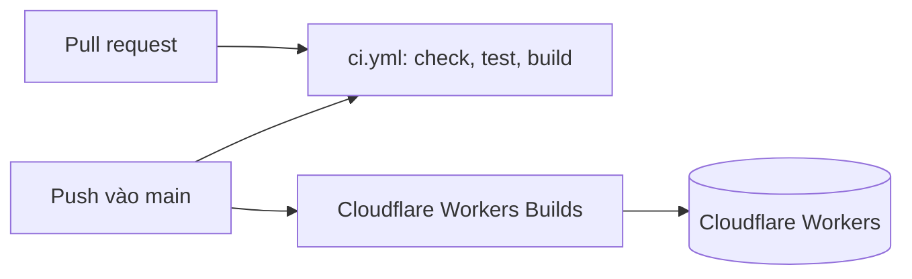

# CI/CD và triển khai

- **CI (GitHub Actions)**: `.github/workflows/ci.yml` chạy khi có pull request và khi push vào `main`: `bun install --frozen-lockfile` → `bun run check` → `bun run test` → `bun run build` (Bun `1.4.3` khớp `devEngines`; action ghim theo major `actions/checkout@v7`, `oven-sh/setup-bun@v2`).
- **CD (Cloudflare Workers Builds)**: GitHub App của Cloudflare tự build và `wrangler deploy` mỗi lần push `main`. Không có workflow deploy và không cần secret Cloudflare trên GitHub.
- `.github/dependabot.yml`: cập nhật hằng tuần cho `github-actions` và `bun` (gom minor/patch).

## Thiết lập Workers Builds (một lần, trên dashboard)

Cloudflare dashboard → Workers & Pages → `ai-la-trieu-phu` → Settings → Builds → Connect (cài GitHub App, chọn repo `buiducnhat/ai-la-trieu-phu`):

| Mục                          | Giá trị                                                                                          |
| ---------------------------- | ------------------------------------------------------------------------------------------------ |
| Production branch            | `main`                                                                                           |
| Build command                | `bun run build`                                                                                  |
| Deploy command               | `bunx wrangler deploy` (không dùng `npx`: `devEngines` yêu cầu bun nên npm báo `EBADDEVENGINES`) |
| Root directory               | `/`                                                                                              |
| Build variable `BUN_VERSION` | `1.4.3` (mặc định của image là 1.2.15, thấp hơn phiên bản dự án dùng)                            |

Tên Worker trên dashboard phải khớp `name` trong `wrangler.jsonc` (`ai-la-trieu-phu`). `vp build` (plugin Cloudflare) sinh `dist/server/wrangler.json` và `.wrangler/deploy/config.json`; `wrangler deploy` tự đọc cấu hình chuyển hướng này.

Bí mật runtime lưu trên Cloudflare, giữ nguyên qua các lần deploy: `bunx wrangler secret put GAME_SECRET` (bắt buộc), `LLM_API_KEY` (tùy chọn). Biến không bí mật: khối `vars` của `wrangler.jsonc`. Deploy thủ công vẫn dùng được: `bun run deploy` (cần `wrangler login`).

Khuyến nghị bật branch protection cho `main` yêu cầu check `Check, test, build` của PR.

## Tên miền

Production chạy tại `https://ailatrieuphu.buiducnhat.work`, khai báo bằng `routes` (`custom_domain: true`) trong `wrangler.jsonc`; `wrangler deploy` tự tạo bản ghi DNS và chứng chỉ, miễn là zone `buiducnhat.work` nằm trong cùng tài khoản Cloudflare. Title/description/Open Graph/canonical nằm ở `src/routes/__root.tsx` (`SITE_URL`, `SITE_TITLE`, `SITE_DESCRIPTION`); đổi domain thì sửa cả hai nơi.
