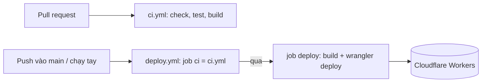

# CI/CD và triển khai

Hai workflow trong `.github/workflows/`, action ghim theo major (`actions/checkout@v7`, `oven-sh/setup-bun@v2`, `cloudflare/wrangler-action@v4`), Bun `1.4.3` (khớp `devEngines`).

| Workflow     | Kích hoạt                              | Việc                                                                                                                 |
| ------------ | -------------------------------------- | -------------------------------------------------------------------------------------------------------------------- |
| `ci.yml`     | `pull_request`, `workflow_call`        | `bun install --frozen-lockfile` → `bun run check` → `bun run test` → `bun run build`                                 |
| `deploy.yml` | `push` vào `main`, `workflow_dispatch` | Gọi `ci.yml`; nếu qua thì `bun run build` rồi `wrangler deploy` (environment `production`, không hủy deploy chạy dở) |

- `vp build` (plugin Cloudflare) sinh `dist/server/wrangler.json` và `.wrangler/deploy/config.json`; `wrangler deploy` tự đọc cấu hình chuyển hướng này, không cần chỉ đường dẫn.
- `.github/dependabot.yml`: cập nhật hằng tuần cho `github-actions` và `bun` (gom minor/patch).

## Thiết lập một lần

GitHub → Settings → Secrets and variables → Actions (nên đặt trong environment `production`):

| Secret                  | Nguồn                                               |
| ----------------------- | --------------------------------------------------- |
| `CLOUDFLARE_API_TOKEN`  | Cloudflare token, mẫu "Edit Cloudflare Workers"     |
| `CLOUDFLARE_ACCOUNT_ID` | Cloudflare dashboard → Workers & Pages (Account ID) |

Bí mật runtime của Worker **không** đi qua CI; chúng được lưu trên Cloudflare và giữ nguyên qua các lần deploy. Đặt một lần: `bunx wrangler secret put GAME_SECRET` (bắt buộc), `LLM_API_KEY` (tùy chọn). Biến không bí mật: khối `vars` của `wrangler.jsonc`.

Khuyến nghị bật branch protection cho `main` yêu cầu check `Check, test, build` của PR.

## Tên miền

Production chạy tại `https://ailatrieuphu.buiducnhat.work`, khai báo bằng `routes` (`custom_domain: true`) trong `wrangler.jsonc`; `wrangler deploy` tự tạo bản ghi DNS và chứng chỉ, miễn là zone `buiducnhat.work` nằm trong cùng tài khoản Cloudflare với token. Title/description/Open Graph/canonical nằm ở `src/routes/__root.tsx` (`SITE_URL`, `SITE_TITLE`, `SITE_DESCRIPTION`); đổi domain thì sửa cả hai nơi.
