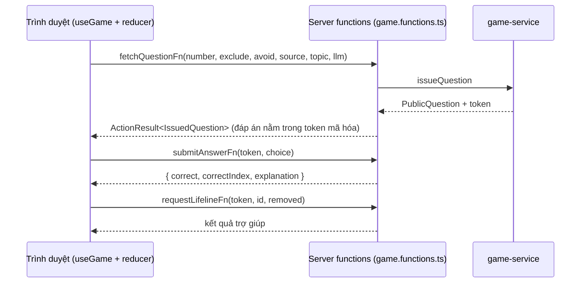

# Luồng chơi và ranh giới client/server

TanStack Start (React 19, Vite) chạy trên Cloudflare Workers, một ứng dụng duy nhất (không có backend tách). Trạng thái ván chơi nằm ở trình duyệt; mọi thứ cần đáp án đúng đi qua server.

## Quy tắc quan trọng

- **Engine thuần** (`src/lib/game/engine.ts`): reducer `reduce(state, event)` không gọi mạng. Các phase: `idle → loading → choosing → locking → revealed → ended`. `useGame` nối reducer với server.
- **Không lộ đáp án**: client chỉ nhận `PublicQuestion` + `token`. Token là AES-256-GCM chứa câu hỏi, đáp án, giải thích, hạn 6 giờ (`src/server/token.ts`). Stateless nên chạy được trên Workers; **`GAME_SECRET` bắt buộc ở production** (thiếu thì `getKey` ném lỗi) vì mỗi isolate Workers có bộ nhớ riêng, khóa ngẫu nhiên theo tiến trình sẽ làm token không giải mã được ở isolate khác. Chỉ chống xem trộm qua DevTools, không chống gian lận có chủ đích.
- **Mọi lệnh gọi server là server function** (`src/server/game.functions.ts`, `createServerFn` + `.validator(zod)`): `getPublicConfigFn` (loader của route `/`), `fetchQuestionFn`, `submitAnswerFn`, `requestLifelineFn`. Chúng là fetch độc lập, không bị xếp hàng, nên nạp trước câu kế (gọi LLM, tới 45 s) không chặn việc chấm đáp án. (Bản Next.js cũ từng bị trễ vì Server Action của Next chạy tuần tự; đã đo trên bản Start/workerd: khóa → kết quả 1,6 s khi LLM giả lập chậm 8 s.) Handler trả `ActionResult` (`ok`/`error`) cho lỗi nghiệp vụ; lỗi mạng/validate được `useGame` quy về `ok:false`.
- **CSRF**: Start tự gắn `createCsrfMiddleware` cho server function (cần header `Sec-Fetch-Site`/`Origin`/`Referer`) vì repo không có `src/start.ts`.
- **Nạp trước**: khi nguồn không phải `bank`, hook gọi trước câu `n+1` ngay khi câu `n` hiện ra; kết quả cache theo `(số câu, lần thử)` trong `useGame` (cũng chống gọi đôi của StrictMode).
- **Khoảng chờ hồi hộp** `SUSPENSE_MS = 1600` giữa lúc khóa và lúc mở đáp án (`src/hooks/use-game.ts`).
- Sau "Dừng cuộc chơi", client vẫn gọi `submitAnswer` để hiện đáp án đúng (không ảnh hưởng tiền).
